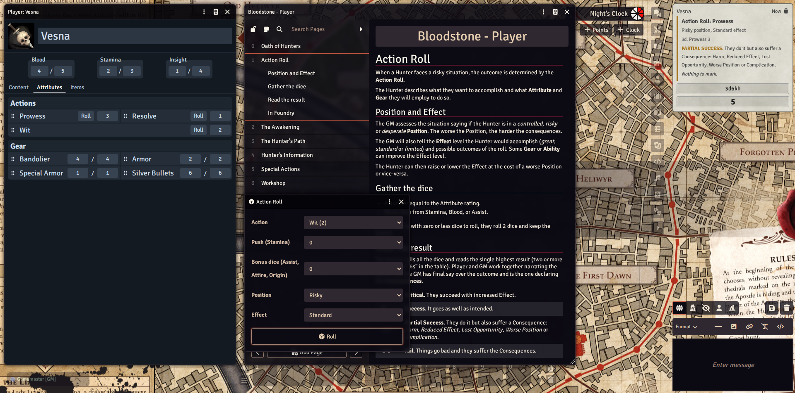
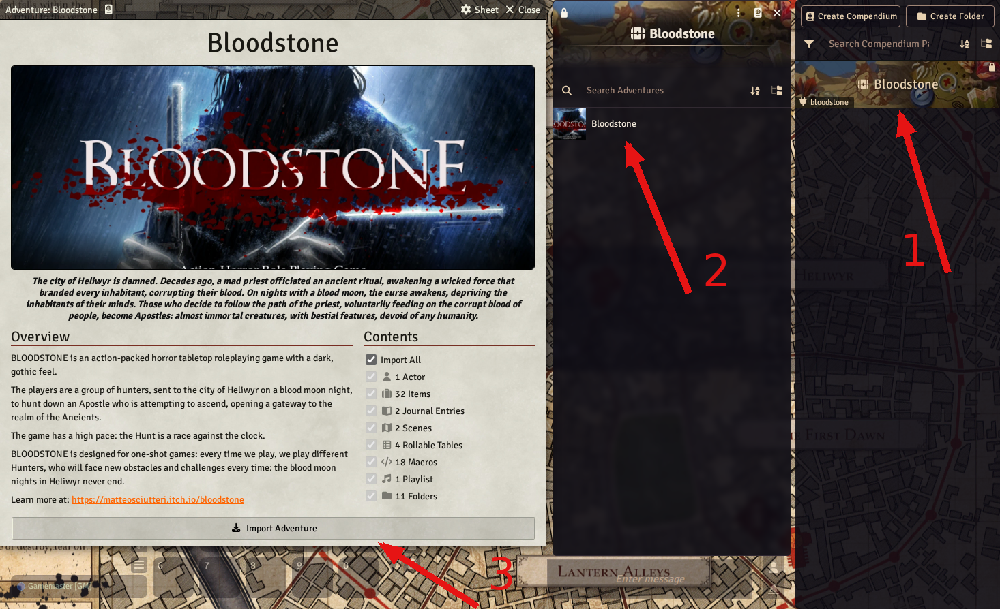

# Bloodstone - Action-Horror mini Forged in the Dark
The city of Heliwyr is damned. Decades ago, a mad priest officiated an ancient ritual, awakening a wicked force that branded every inhabitant, corrupting their blood. On nights with a blood moon, the curse awakens, depriving the inhabitants of their minds. Those who decide to follow the path of the priest, voluntarily feeding on the corrupt blood of people, become Apostles: almost immortal creatures, with bestial features, devoid of any humanity.

BLOODSTONE is an action-packed horror tabletop roleplaying game with a dark, gothic feel.
The players are a group of hunters, sent to the city of Heliwyr on a blood moon night, to hunt down an Apostle who is attempting to ascend, opening a gateway to the realm of the Ancients. 

The game has a high pace: the Hunt is a race against the clock. 
BLOODSTONE is designed for one-shot games: every time we play, we play different Hunters, who will face new obstacles and challenges every time: the blood moon nights in Heliwyr never end.

This module brings Bloodstone to Foundry VTT on the Text-Based Actors system: a Hunter with roll buttons, the gear, the player and GM journals for game version 1.4, the four GM tables, the map of Heliwyr, and clocks through Global Progress Clocks.

<table>
<thead>
  <tr>
    <th>
      <p align="center">
        
      </p>
    </th>
  </tr>
</thead>
</table>

# Documentation
You need Foundry VTT v14, the Text-Based Actors (TAF) system 3.3.0 and the Global Progress Clocks module. Dice So Nice and Dice Tray are optional: the first shows the dice rolling in 3D, the second adds dice buttons below the chat.

You need the [PDF](https://matteosciutteri.itch.io/bloodstone) to play.

1. Create a world with the Text-Based Actors system and activate Bloodstone and Global Progress Clocks.
2. In the sidebar, open **Compendium Packs** and then the **Bloodstone** pack.
3. Open the Bloodstone adventure and click **Import Adventure**.

<table>
<thead>
  <tr>
    <th>
      <p align="center">
        
      </p>
    </th>
  </tr>
</thead>
</table>

The import brings the Hunter, an actor for each Apostle, danger and weird character in the GM tables (a name and a blank sheet, for an image and a token), 32 items (origins, memories, attire, trick weapons, firearms, tools and bandolier items), the Bloodstone - Player and Bloodstone - GM journals, a cover scene and the map of Heliwyr, four roll tables for the GM, the roll, clock and Start the Hunt macros, and a reading of the Oath of Hunters.

Give each player a copy of the Hunter. On the Attributes tab, the **Roll** button beside Prowess, Resolve and Wit opens the Action Roll. On the Items tab, the **Use** button beside a trick weapon or a firearm rolls it. The Resist macro rolls Resist. The Bloodstone Rolls macro puts every roll in one window, for the hotbar. The chat card reads the result and says what to mark; the sheet is not changed for you.

TAF gives every new actor the world's default attributes. To make them Bloodstone's, open the Hunter as GM, open the sheet's header menu (⋮) and choose **Save Attributes as Defaults**. Do it after importing the adventure: an actor imported without attributes, like the non-player characters, also gets the defaults.

The Clocks macro folder holds the Night's Clock (8 segments) and clocks of 4, 6 and 8 segments. Each macro adds its clock to Global Progress Clocks. The Bloodstone - GM journal explains when to use them.

Before the session, the GM runs the Start the Hunt macro. It draws from the tables the secret cathedral, the Apostle, three locations, the opening obstacle and a weird character, and the GM can change any of them or draw again. Then it creates the Night's Clock and a journal only the GM sees, with a page for each choice, pinned to the map of Heliwyr as notes, with hidden arrows for the routes between the places.

# Installation


[](https://buymeacoffee.com/mestredigital) [](https://mestredigital.online/pages/projetos-en)

## Installation
Search **Bloodstone** in the Foundry VTT module browser.

## Manual installation
Paste this manifest link in the module browser:

```
https://github.com/brunocalado/bloodstone/releases/latest/download/module.json
```

# About
If you want to learn about this game go to [Bloodstone](https://matteosciutteri.itch.io/bloodstone) and get the PDFs.

This module follows version 1.4 of the game.

# Changelog
Learn about changes at [CHANGELOG](CHANGELOG.md).

# License
The code and the content of this module are under different licenses.

The code (`scripts/`, `styles/` and `tools/`) is under the GNU General Public License version 3. See [LICENSE](LICENSE).

The content (the journals, the Hunter, the items, the roll tables and the map) comes from [Bloodstone](https://matteosciutteri.itch.io/bloodstone), a game by Matteo Sciutteri licensed under [CC BY-NC-SA 4.0](https://creativecommons.org/licenses/by-nc-sa/4.0/). It was adapted for Foundry VTT and is shared under the same license, so it cannot be used commercially. Matteo Sciutteri gave permission to update this module and add the map, in the comments on [the game's page](https://matteosciutteri.itch.io/bloodstone) (November 2026): asked "Can I update the Foundry VTT Module and add the map?", he answered "of course! Please do it."

This work is based on Blades in the Dark, product of One Seven Design, developed and authored by John Harper, and licensed for our use under the Creative Commons Attribution 3.0 Unported license.

# Assets
- Oath - PTBT -> Oath of Hunter - Bloodstone © 2022 by Mestre Digital is licensed under [CC BY-SA 4.0](https://creativecommons.org/licenses/by-sa/4.0/)
- Map of Heliwyr -> by Matteo Sciutteri, licensed under [CC BY-NC-SA 4.0](https://creativecommons.org/licenses/by-nc-sa/4.0/): https://matteosciutteri.itch.io/bloodstone. Converted from the game's map PDF to a WebP image for the scene, with the author's permission (see License).
- Clock icons -> from [game-icons.net](https://game-icons.net), licensed under [CC BY 3.0](https://creativecommons.org/licenses/by/3.0/)

# Mestre Digital
About this module creator: https://sites.google.com/view/mestredigitalmodules
